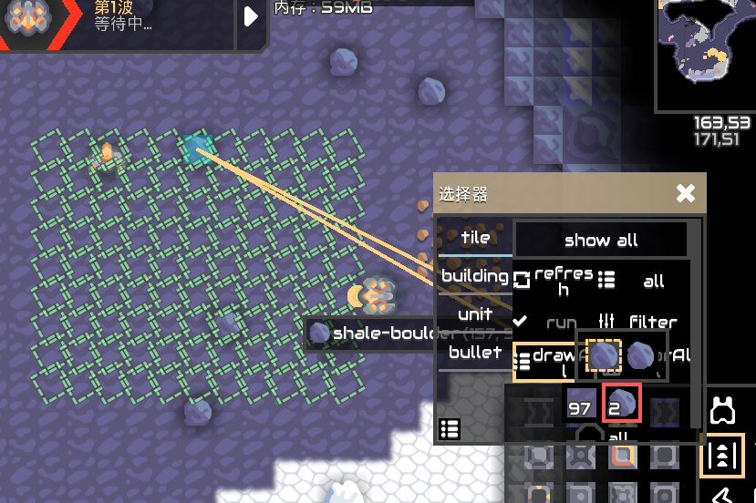

[← 文档导航](../index.md)

# Selection：选择器

> 入口：mod-tools 菜单 → **Selection** · 平台：桌面端 / Android

选择器用来在游戏里框选目标，并对选中项批量执行内置命令；例如改地板、给建筑塞物品、给单位回血/上状态、批量清除。

## 选择类型

- `Tile`：地块
- `Building`：建筑
- `Bullet`：子弹
- `Unit`：单位
- `Others`：其它实体

支持固定焦点窗口（`Ctrl` + `Alt` 切换），这样在游戏里点选时窗口不会被其他界面挡住。

## 常用命令

| 类型 | 命令 |
|:--|:--|
| 地块 | 设置地板、保留/重置 Overlay |
| 建筑 | 无限血量、物品/液体设置、物品/液体统计、杀死、清除 |
| 单位 | 无限血量、切换队伍、治疗、杀死、清除、强制清除、清除/应用状态 |
| 子弹 | 清除 |
| 实体 | 清除 |

命令只对当前选中列表生效；列表为空时不会执行。部分命令会弹出二次确认。

## 动态选区

勾选动态选区后，选区会跟随当前鼠标位置变化，适合连续刷地形。注意：动态选区**不会自动更新 `Tile` 对象本身**，需要重新选择一次才会拿到最新地块。

## 其它

- 刷新按钮：重新拉取选中项图标与名称。
- 选择全部：把当前类型的所有目标加入选区。
- 清除选择：清空当前选区。
- 筛选：按名称/类型过滤选择列表。

> 键位可在 mod-tools 的按键设置里改；固定焦点窗口的默认键是 `Ctrl` + `Alt`。
