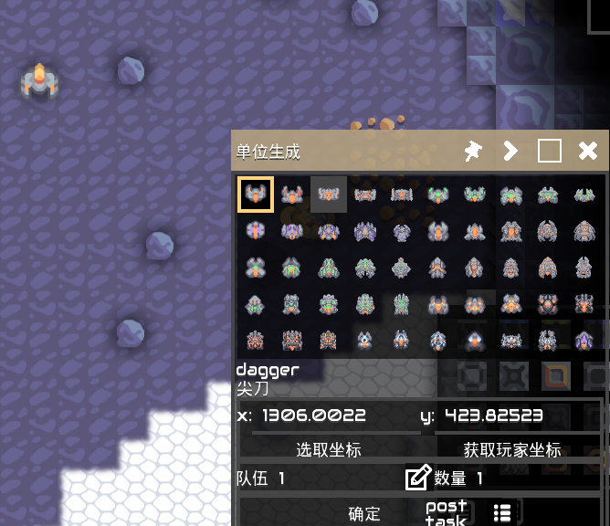

[← 文档导航](../index.md)

# UnitSpawn：单位生成

> 入口：mod-tools 菜单 → **UnitSpawn** · 平台：桌面端 / Android

UnitSpawn 用来快速在指定位置生成单位：选队伍、选单位、填坐标和数量，也可以把这次生成配置提交成 Executor 任务，便于重复执行或定时批量生成。

## 基本操作

- **选择单位**：从单位列表选一个 `UnitType`。
- **选择队伍**：`sharded`、`crux` 等原版队伍。
- **坐标**：`x` / `y` 可以直接填，也可以点 **Select a position** 在地图上点选。
- **数量**：一次生成的数量；勾选 **Multi** 可以连续生成多个点。
- **生成**：`OK` 立即生成。

单位名称标签支持右键/长按复制为 JS 变量，方便在 Tester 里继续引用。

## Post Task

**Post Task** 会把当前配置转换成一段生成代码，作为一个新任务挂到 Executor 的 `unitSpawn` 节点下：

- 任务默认使用**世界计时器**，只在游戏未暂停时执行；
- 任务名是单位本地化名称，来源里带坐标/队伍/数量；
- 提交后会弹窗，点 **View** 直接打开 Executor 查看任务。

在 Executor 里可以对这个任务执行/循环/打断/编辑/删除；生成代码也可以在右键菜单里复制出来。

## 动态数量与单位上限

工具菜单里可以切换单位上限（`unitUnlimited`）等开关；生成数量很大时注意性能，建议分批或先用较小数量试。

> 生成任务默认只执行一次；需要持续刷兵时，在 Executor 里点循环按钮。
