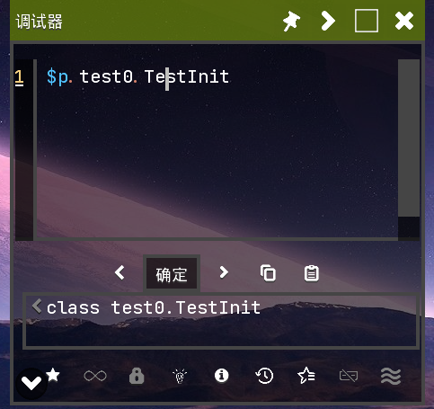
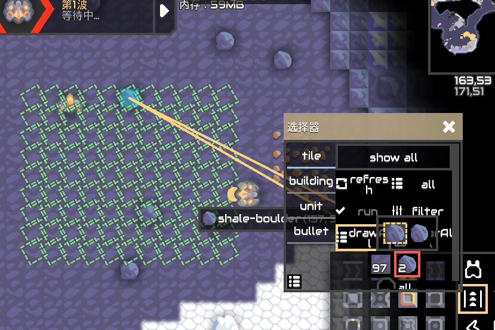
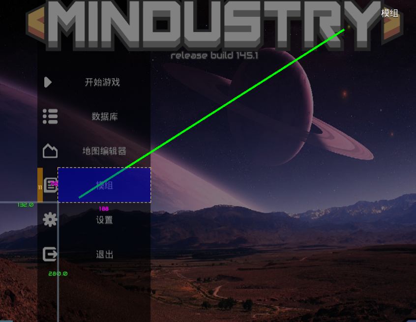
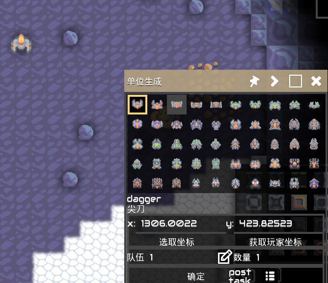

# 快速开始

**Mod Tools** 是面向 **Mindustry v7** 的开发工具箱：JS 编辑器、UI 审查器、内容浏览器、单位生成器、任务执行器和开发期热重载都在游戏内。

这页帮你完成安装并跑起第一个脚本；左侧目录按「工具 → 进阶」组织，可以按顺序阅读，也可以直接跳到需要的工具。

## 安装

1. 从 [Releases](https://github.com/i-hope1/mod-tools/releases) 下载最新的 `mod-tools-*.jar`。
2. 放进 Mindustry 的 `mods/` 目录（游戏内「模组」页面可以直接打开该目录）。
3. 启动游戏，在模组设置中启用 **mod-tools**。

要求 **Mindustry v7**（`minGameVersion` 159.2）。桌面端功能完整；Android 端也可以使用，但热重载和部分桌面专用工具不可用。

## 跑第一段 JS

打开 **Tester**，输入：

```js
Log.info("Hello from mod-tools!");
```

按 `Ctrl` + `Shift` + `Enter` 执行，日志会出现在游戏控制台和 Tester 底部的输出区。

## 看一眼 UI 是怎么搭的

按 `Ctrl` + `Shift` + `C` 打开 **ReviewElement**，审查鼠标下的元素；按 `Ctrl` + `Alt` + `D` 显示元素边界。选中元素后可以按 `i` 看详情、按 `e` 直接改字段、按 `l` 做布局体检。

## 工具地图

| 工具 | 能做什么 | 文档 |
|:--|:--|:--|
| **Tester** | 游戏内 Rhino JS 编辑器/执行器，支持历史、启动脚本与 `$` 快捷 API | [Tester](/guide/tester) |
| **Executor** | 任务树执行器：执行、循环、打断、状态过滤与自定义 JS 任务 | [Executor](/guide/executor) |
| **Selection** | 选择地块/建筑/子弹/单位，并对选中项执行命令 | [Selection](/guide/selection) |
| **UnitSpawn** | 按队伍、坐标、数量生成单位，可提交为 Executor 任务 | [UnitSpawn](/guide/unit-spawn) |
| **ReviewElement** | 审查 UI 元素树、实时改字段、布局体检、复制为 JS 变量 | [ReviewElement](/guide/review-element) |
| **ShowUIList / ShowInfoWindow** | 浏览 UI 资源与任意对象详情 | [UI 工具](/guide/ui-inspector) |
| **Frag / Window / WindowManager** | 窗口切换、最小化、贴边与强制显示 | [窗口](/guide/windows) |
| **ContentList / LogDisplay / Profiler / Pause** | 内容浏览器、游戏内日志、性能分析、实验性暂停 | [其他工具](/guide/misc) |
| **扩展** | Override Scene、HTTP 重定向 | [扩展](/guide/extensions) |

## 继续阅读

- **热重载**：[HotSwap / Remold](/guide/hotswap) — 桌面端 JBR 下修改代码/资源后原位替换。
- **开发与构建**：[开发与构建](/guide/development) — JDK、Gradle、运行和测试命令。

## 截图

| | |
|:--:|:--:|
|  |  |
|  |  |
