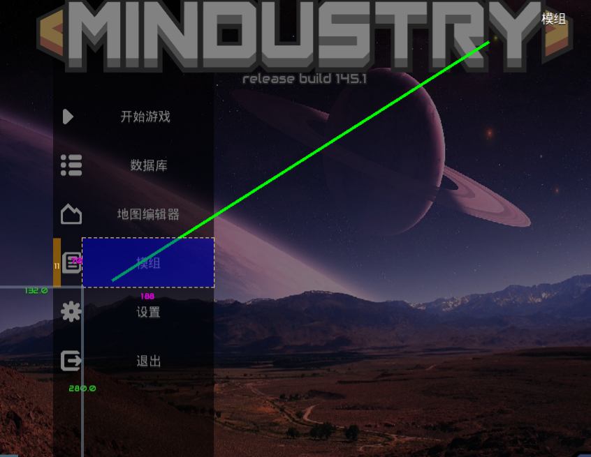

# ReviewElement：审查元素

> 入口：mod-tools 菜单 → **ReviewElement**（或按 `Ctrl` + `Shift` + `C` 直接审查鼠标下的元素） · 平台：桌面端 / Android

ReviewElement 用来拆 Arc 的 UI 树：查看元素的层级、位置、样式、Cell 属性和字段值，实时改字段看效果，把元素复制成 JS 变量，或者跑一次布局体检。

## 基础操作

- 显示元素列表；双击元素可复制为 JS 变量。
- `Ctrl` + `Shift` + `C`：审查鼠标/手指下的元素。
- `Ctrl` + `Alt` + `D`：显示元素边界。
- 选择不可触摸的元素：
  - 移动端：两根手指筛选当前元素；
  - PC：按 `F` 筛选当前元素。
- `'null` 表示 `null` 指针。

## 元素快捷键

选中元素后：

| 键 | 作用 |
|:--|:--|
| `i` | 显示详情（ShowInfoWindow） |
| `p` | Image 元素：打开 DrawablePicker 换贴图 |
| `del` | 删除元素（`Shift` 跳过确认） |
| `<` / `>` | 折叠/展开 Group |
| `f` | 固定浮动 Info 栏 |
| `r` | 调用元素的 method |
| `e` | 打开元素编辑器，实时修改字段 |
| `y` | 复制元素路径 |
| `l` | 对元素做布局体检（LayoutReportWindow） |
| `c` | 打开 Cell 详情（CellDetailsWindow） |

## 实时编辑与布局体检

- **元素编辑器**（`e`）：直接改 `Element` 的字段/属性，改完立即生效，不需要重新编译；适合调尺寸、颜色、对齐、可见性。
- **布局体检**（`l`）：从当前元素向下扫描，列出尺寸非法、越出父节点等布局异常，并标出问题元素。
- **Cell 详情**（`c`）：查看包裹元素的 `Cell` 的 pad/size/colspan/align 等属性。

## 自定义 Viewer

ShowInfoWindow 可以按类型注册自定义 Viewer，把不友好的对象渲染成表格/树。文件放在 `%MindustryData%/mod_tools/` 下，具体格式见 [ShowInfoWindow](/guide/ui-inspector)。

