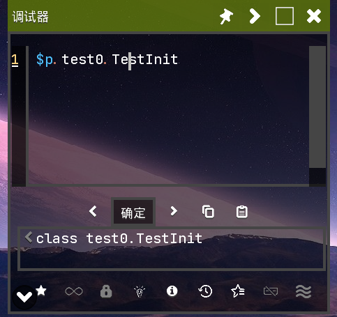
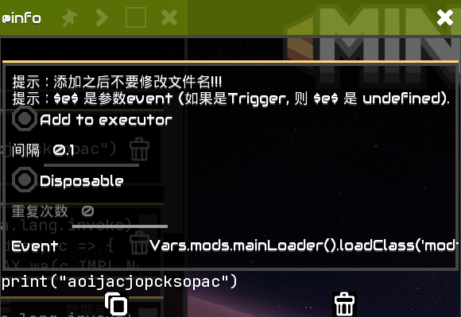

# Tester：游戏内 JS 编辑器

> 入口：mod-tools 菜单 → **Tester** · 平台：桌面端 / Android（部分快捷键仅桌面端）

Tester 用 Rhino 在游戏进程内执行 JavaScript，可以直接访问 Mindustry / Arc 的类和当前游戏状态，适合快速试 API、改 UI、写启动脚本。

## 能做什么

- 编辑并执行 JavaScript，支持代码补全、语法高亮与历史记录。
- 收藏常用代码片段；长按收藏夹中的代码可加入启动项。
- 在游戏启动时自动执行 `startup/` 目录下的 `.js`。
- 内置 `unsafe`、`lookup` 与 `$`（`IntFunc`）快捷 API。
- 右侧可查看执行结果与异常堆栈。

## 快捷键

| 操作 | 快捷键 |
|:--|:--|
| 立即执行当前代码 | `Ctrl` + `Shift` + `Enter` |
| 切换历史记录 | `Ctrl` + `Shift` + `↑` / `↓` |
| 查看详细信息 | `Ctrl` + `Shift` + `D` |
| 预览 `Texture` | `Alt` + `V` |

## `$`（IntFunc）速查

| 别名 | 对象 / 表达式 | 说明 |
|:--|:--|:--|
| `IntFunc` | `$` | 快捷 API 入口 |
| `$p` | `Packages` | Java 包 |
| `$.J`, `$.I`, ... | `long.class`, `int.class` | 基本类型的编码 |
| `$.long`, `$.int`, ... | `long.class`, `int.class` | 同上 |
| `$.duo`, `$.copper` | `Blocks.duo`, `Items.copper` | 按名称获取 `UnlockableContent` |
| `$.items`, `$.liquids`, ... | `Items`, `Liquids`, ... | 内容集合 |
| `$.item(name/id)`, `$.unit(name/id)`, ... | 对应名称/id 的内容 | 按名称或 id 获取内容 |
| `$.forEach(list, func)` | `for (let v of list) { ... }` | Mindustry 的 Rhino 不支持直接 for-of 遍历 Java 对象 |
| `$.toArray(iterable)` | `[...iterable]` | 转为数组 |
| `$.range(int)`, ... | 生成器（from → to, step） | 类似 Python 的 `range` |
| `$.dialog(text/drawable/texture)` | - | 查看文本 / Drawable / Texture |

`IntFunc` 的源码在 [`src/modtools/utils/JSFunc.java`](https://github.com/I-hope1/mod-tools/blob/main/src/modtools/utils/JSFunc.java)。

## 启动脚本与收藏

- 启动脚本目录：`%MindustryData%/mod_tools/b0kkihope/startup/`，游戏启动时按文件加载。
- 收藏夹目录：`%MindustryData%/mod_tools/b0kkihope/bookmarks/`。
- 收藏夹里长按代码可加入启动项；加入后会生成启动任务，显示在 Executor 的 **JS startup** 节点下。
- 启动脚本添加后**不要改文件名**：启动项按文件名记录；改文件名会导致配置对不上。

> 启动脚本和自定义任务都由 [Executor](/guide/executor) 调度，可以在那里查看状态、打断或删除。
