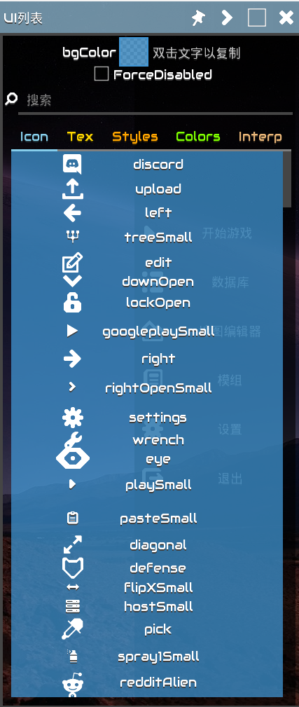

# UI 工具：ShowUIList / ShowInfoWindow

> 入口：mod-tools 菜单 → **ShowUIList**；ShowInfoWindow 可从 ReviewElement 按 `i` 打开

## ShowUIList（UI 列表）

ShowUIList 把游戏里注册的 UI 资源列成可搜索的标签页，用来找贴图名、样式、颜色和 action：

| 标签页 | 内容 |
|:--|:--|
| `Icon` | 图标 |
| `Tex` | 纹理 |
| `Styles` | `Styles` / `HopeStyles` 里的样式 |
| `Colors` | 调色板 |
| `Interp` | 插值器 |
| `Actions` | Arc 的 action |

- 双击名称可复制到剪贴板；长按/右键可按提示复制为 JS 变量。
- 支持搜索过滤；`ForceDisabled` 可以强制查看被禁用状态的预览。
- 适合在 Tester 里写 UI 前先确认资源名。

## ShowInfoWindow（对象信息）

ShowInfoWindow 用表格/树展示任意 Java 对象的字段、方法、数组/Map 内容和格式化后的值：

- `'null` 表示 `null` 指针；`Ctrl` + `F` 聚焦搜索框，`Ctrl` + `Shift` + `F` 聚焦并清空搜索。
- 对 `Element`，可以从 ReviewElement 按 `i` 打开；普通对象则从菜单/JS 主动打开。
- 复杂对象支持按类型注册 **Custom Viewer**，把不友好的结构渲染成可读表格。

### Custom Viewer

把自定义 viewer 文件放到 `%MindustryData%/mod_tools/` 下即可被加载；格式见仓库中的 viewer 示例与注释。

> ShowInfoWindow 也用于 ReviewElement 的 `i` 详情、Cell 详情等场景，是排查 UI 数据的主要窗口。
