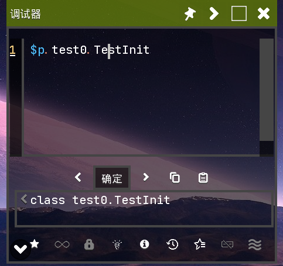
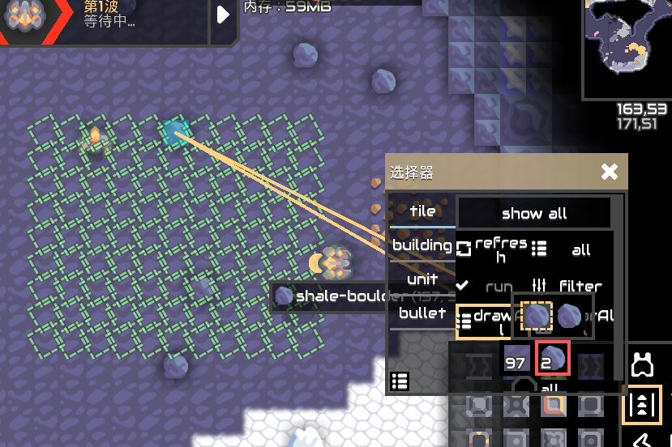
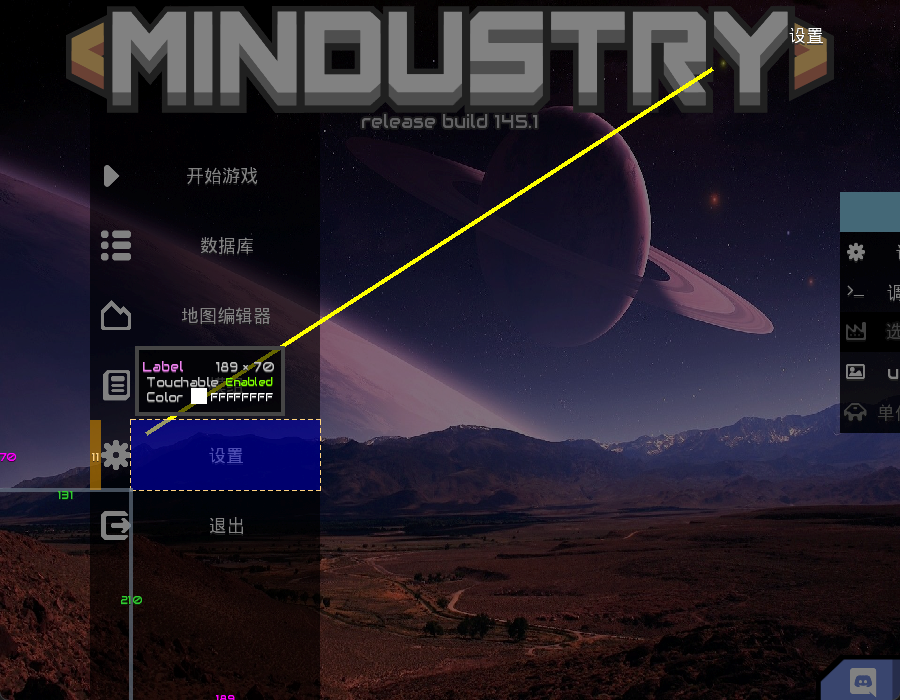
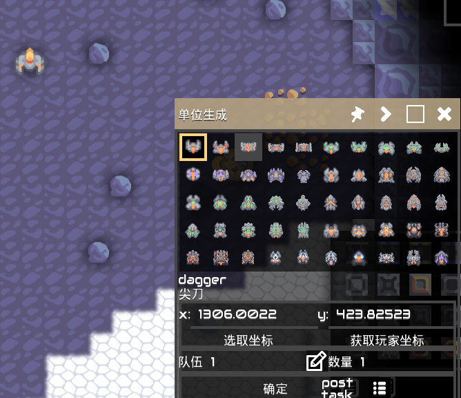

[English](index_en.md) | 简体中文

# Mod Tools 文档导航

> 面向 **Mindustry v7** 的开发工具集。这里只做导航；每个工具的具体用法见对应专题页。

如果你还没安装，先看 [README 的安装与快速开始](https://github.com/I-hope1/mod-tools#安装)。

## 工具索引

| 工具 | 一句话说明 | 文档 |
|:--|:--|:--|
| **Tester** | 游戏内 JS 编辑器/执行器，支持历史、启动脚本与 `$` 快捷 API | [01-tester.md](features/01-tester.md) |
| **Executor** | 任务树执行器：执行、循环、打断、状态过滤与自定义 JS 任务 | [02-executor.md](features/02-executor.md) |
| **Selection** | 选择地块/建筑/子弹/单位，并对选中项执行命令 | [03-selection.md](features/03-selection.md) |
| **UnitSpawn** | 按队伍、坐标、数量生成单位，可提交为 Executor 任务 | [04-unit-spawn.md](features/04-unit-spawn.md) |
| **ReviewElement** | 审查 UI 元素树、实时改字段、布局体检、复制为 JS 变量 | [05-review-element.md](features/05-review-element.md) |
| **ShowUIList / ShowInfoWindow** | 浏览 UI 资源与任意对象详情 | [06-ui-inspector.md](features/06-ui-inspector.md) |
| **Frag / Window / WindowManager** | 窗口切换、最小化、贴边与强制显示 | [07-windows.md](features/07-windows.md) |
| **ContentList / LogDisplay / Profiler / Pause** | 内容浏览器、游戏内日志、性能分析、实验性暂停 | [08-misc.md](features/08-misc.md) |
| **扩展** | Override Scene、HTTP 重定向 | [09-extensions.md](features/09-extensions.md) |

## 热重载

从 1.7 开始，热重载由 [Remold](https://github.com/I-hope1/Remold) 提供。桌面端 JBR 下可以监听编译输出目录，把 `.class`/资源变化原位替换进运行中的游戏。

- 启用方式、监视路径与设置项：[hotswap.md](hotswap.md)
- Remold 的完整原理、限制与状态：[Remold README](https://github.com/I-hope1/Remold#readme)

## 开发与构建

- 仓库结构、JDK 版本、构建/运行/测试命令：[development.md](development.md)
- 构建与 CI 配置：[build.gradle](https://github.com/I-hope1/mod-tools/blob/main/build.gradle)、[.github/workflows](https://github.com/I-hope1/mod-tools/tree/main/.github/workflows)

## 截图

| | |
|:--:|:--:|
|  |  |
|  |  |

> 专题页目前以中文维护；英文入口与概览见 [English index](index_en.md)。
