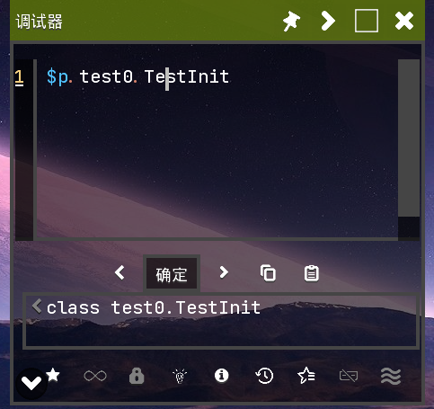
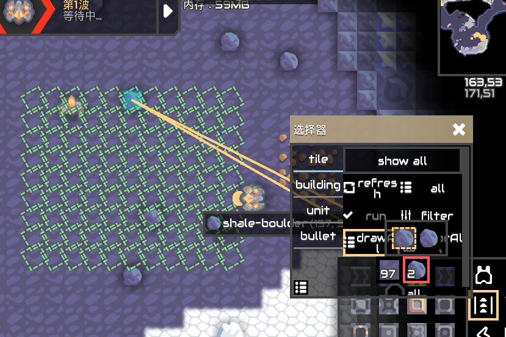
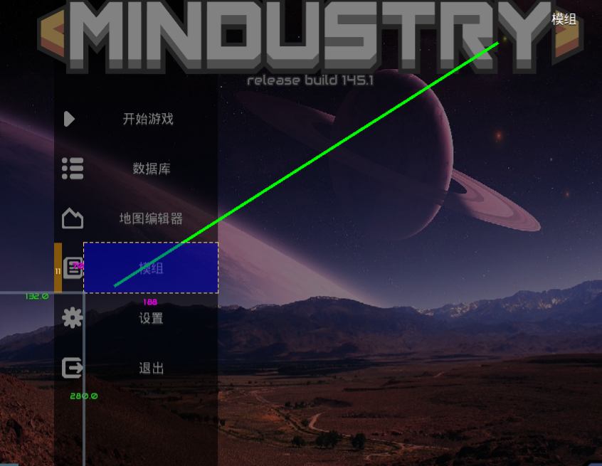
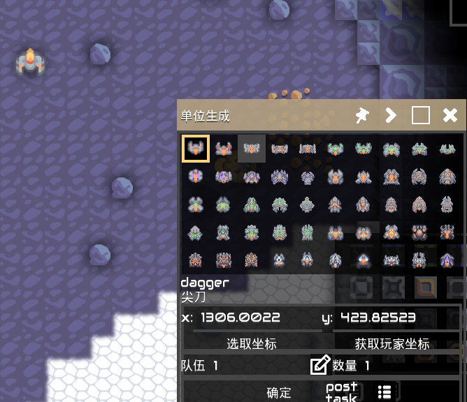

[简体中文](/guide/) | English

# Mod Tools Documentation

> A developer toolbox for **Mindustry v7**. This page is a navigation hub; each tool has its own topic page.

New here? Start with [Installation & quick start](https://github.com/I-hope1/mod-tools/blob/main/README_en.md#installation).

## Tool index

| Tool | In one line | Docs |
|:--|:--|:--|
| **Tester** | In-game JS editor/executor with history, startup scripts and the `$` shortcut API | [Tester](/guide/tester) |
| **Executor** | Task-tree executor: run, loop, interrupt, status filters and custom JS tasks | [Executor](/guide/executor) |
| **Selection** | Select tiles/buildings/bullets/units and run commands on the selection | [Selection](/guide/selection) |
| **UnitSpawn** | Spawn units by team, position and amount; submit as an Executor task | [UnitSpawn](/guide/unit-spawn) |
| **ReviewElement** | Inspect the UI tree, edit fields live, run layout checks, copy as JS | [ReviewElement](/guide/review-element) |
| **ShowUIList / ShowInfoWindow** | Browse UI resources and inspect any object | [UI tools](/guide/ui-inspector) |
| **Frag / Window / WindowManager** | Window switching, minimizing, snapping and force-show | [Windows](/guide/windows) |
| **ContentList / LogDisplay / Profiler / Pause** | Content browser, in-game logs, profiling, experimental pause | [Other tools](/guide/misc) |
| **Extensions** | Override Scene and HTTP redirect | [Extensions](/guide/extensions) |

## Hot reload

Since 1.7, hot reload is provided by [Remold](https://github.com/I-hope1/Remold). On desktop JBR it watches compiled output directories and swaps `.class`/resource changes into the running game in place.

- Enablement, watch paths and settings: [Hot reload](/guide/hotswap)
- Full architecture, limits and status: [Remold README](https://github.com/I-hope1/Remold#readme)

## Development

- Repository layout, JDK version, build/run/test commands: [Development](/guide/development)
- Build and CI configuration: [build.gradle](https://github.com/I-hope1/mod-tools/blob/main/build.gradle), [.github/workflows](https://github.com/I-hope1/mod-tools/tree/main/.github/workflows)

## Screenshots

| | |
|:--:|:--:|
|  |  |
|  |  |

> Topic pages are currently maintained in Chinese; this page and the README provide the English overview.
